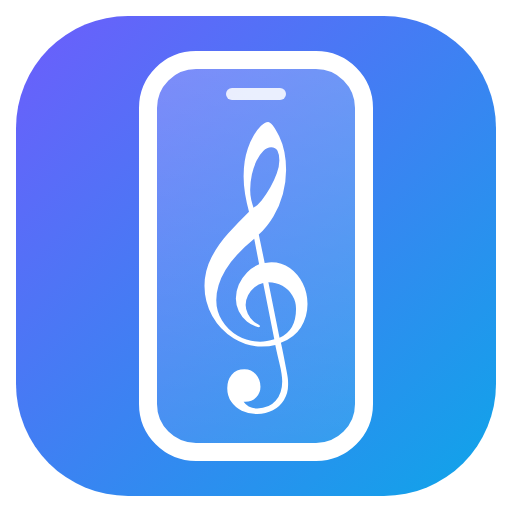
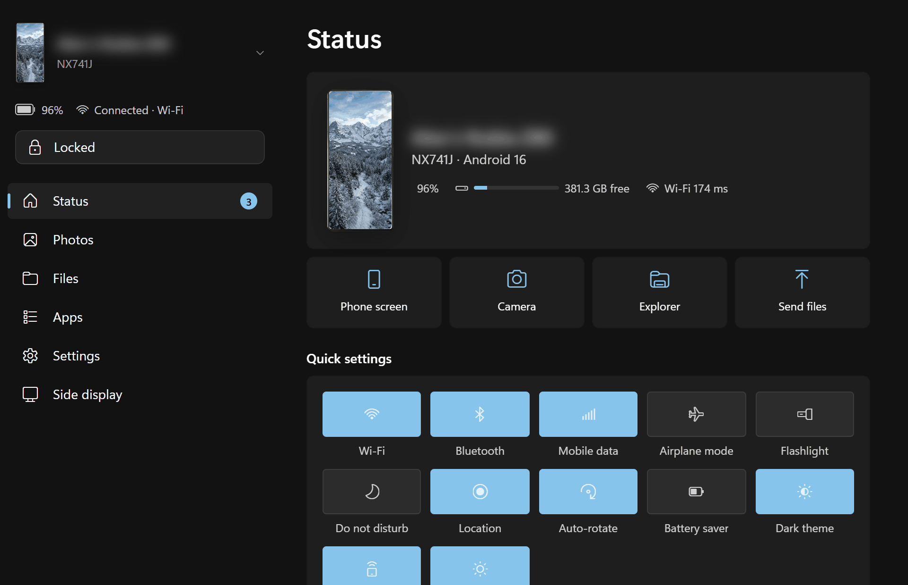
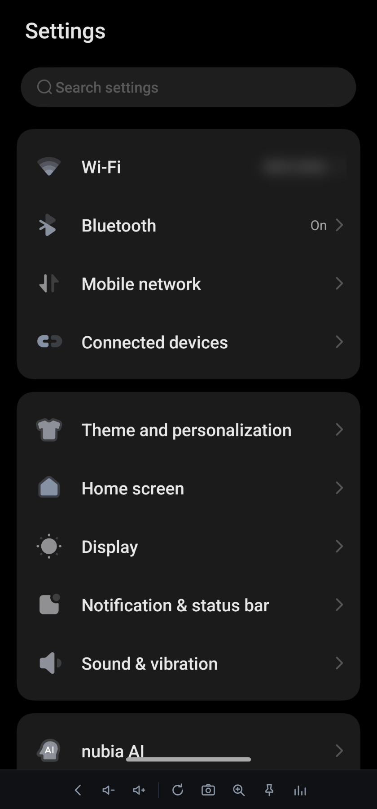
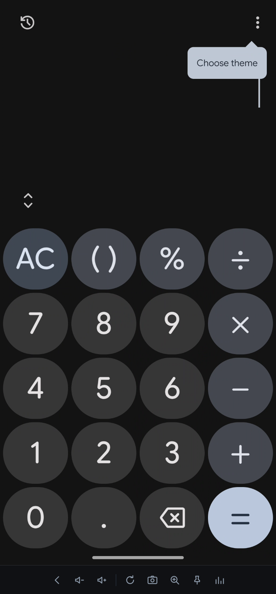
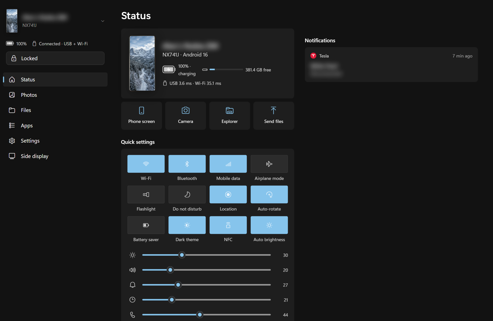
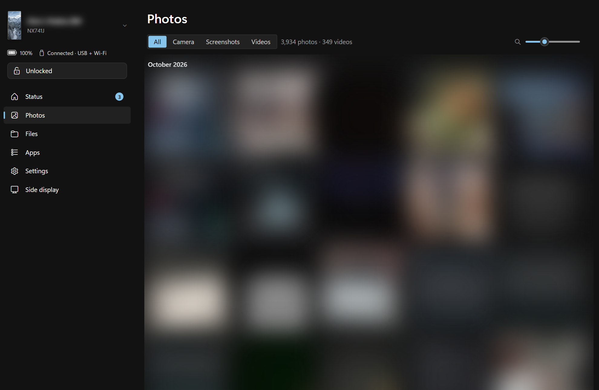
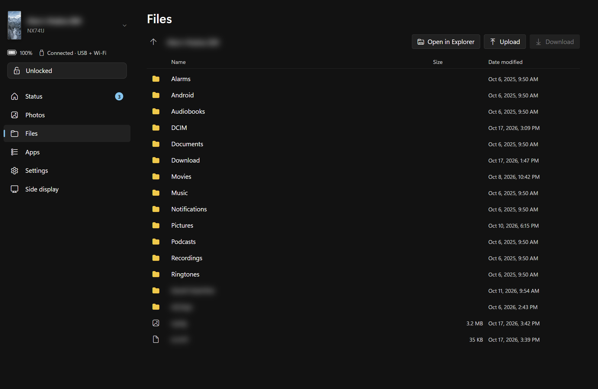
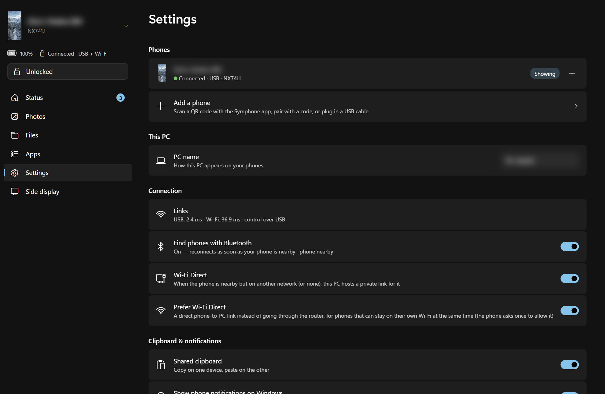
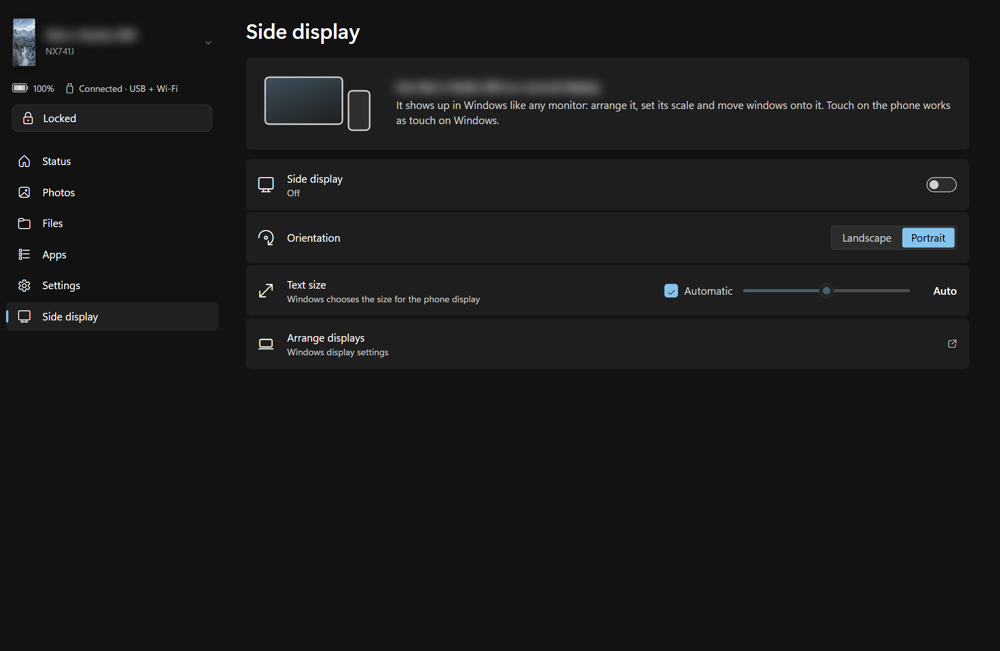

<p align="center"></p>

# Symphone

[](https://github.com/alex-aprm/symphone/releases/latest)
[](https://github.com/alex-aprm/symphone/actions/workflows/android.yml)
[](https://buymeacoffee.com/alexaprm)

**Your Android phone, right on your PC — Windows, macOS or Linux.** Open phone apps in windows and type in them with your
keyboard, answer notifications, browse photos and files, share the clipboard, take calls, use the phone as a webcam
or as a second screen — over USB, Wi‑Fi or both, even while the phone stays locked in your pocket.

<p align="center"></p>

## What you can do

### Phone apps in PC windows

- Open **any phone app in its own window**, side by side with your Windows apps — it works while the phone is
  locked and its screen stays off.
- **Type with your PC keyboard** in any language; the phone's keyboard stays out of the way.
  Scroll and pinch with the touchpad, right-click for Back.
- Windows **resize like desktop apps** (the app re-lays itself out), and a **pin** keeps one on top.
- **Pick the phone up** and use the app there: the PC window softly blurs. Put the phone down and the app is back
  on the PC.
- Apps that forbid screen capture (banking, government ids) say so and offer to continue on the phone.

<p>
  
  &nbsp;
  
</p>

<sub>Real apps in Symphone windows (Wi‑Fi name blurred); the toolbar underneath has Back, volume, rotate,
screenshot, zoom, pin on top and stats.</sub>

### Notifications you can act on



- Phone notifications show up in Windows and on the Status page — **reply inline**, use their buttons, or click to
  open the conversation in a window, exactly where tapping it on the phone would take you.
- Incoming calls ring on the PC; answer with the PC's speakers and mic.
- The Status page also has the phone's quick settings: Wi‑Fi, Bluetooth, flashlight, do not disturb, volume…

<sub>Screenshot with sample notifications; the phone's name is blurred.</sub>

### Photos and files

| Photos | Files |
|---|---|
|  |  |

- **All your photos and videos** at a glance; new shots appear within a second and can be imported automatically.
- **Copy** a photo (Ctrl+C, the toolbar or right-click) and paste it anywhere — into a chat, an email, Word or Explorer.
- The phone's storage is **in Explorer**, next to *This PC*. Copies use USB and Wi‑Fi at the same time.
- Right-click → **Send to → your phone** in Explorer; on the phone, **Share → Send to PC**.

<sub>Photo thumbnails and personal file names blurred.</sub>

### And more

| Settings | Side display |
|---|---|
|  |  |

- **Shared clipboard** — copy on one, paste on the other.
- **Webcam** — the phone's camera as a Windows camera for Teams, Zoom & co., upright however the phone stands.
- **Side display** — the phone as an extra Windows monitor with touch.
- **Sound** — PC audio to the phone, phone audio and mic to the PC.
- **Unlock and lock** the phone from the PC, see its battery at a glance.
- **Several phones and PCs** — switch between them; each phone picks its main PC.
- It reconnects by itself whenever the phone is nearby, and looks like part of Windows (light/dark, accent color,
  translucent window).

## Install

You need **Windows 11** and an **Android 11+** phone.

1. Download **Symphone-…-windows-x64.zip** from [Releases](https://github.com/alex-aprm/symphone/releases/latest)
   and extract it.
2. On the phone, turn on **USB debugging** (Settings › About phone › tap *Build number* 7 times, then Developer
   options › USB debugging) and plug it into the PC.
3. Run `Symphone\install.ps1` (right-click → *Run with PowerShell*). It installs Symphone for your user, puts the
   phone app on the phone and sets everything up — no tapping through permission screens.

After that, USB is optional: the phone connects over Wi‑Fi by itself. More phones can be added from Settings ›
*Add a phone* with a QR code.

Optional extras (one-time, as administrator): phone storage as a native drive in Explorer, a virtual microphone
and firewall rules — `Symphone\setup\admin-setup.ps1`; the side display driver —
`Symphone\sidecar\driver\install.ps1`; the Windows webcam — `Symphone\vcam\install.ps1`.

The Windows app keeps the phone app up to date.

### macOS and Linux

The same app runs on **macOS** (Apple silicon) and **Linux** (Ubuntu 22.04+ / Debian 12+, x86‑64): phone apps in
windows, notifications with replies, photos and files (the phone is mounted in Finder / Files), shared clipboard,
sharing, unlock and audio. The side display, the phone webcam, Wi‑Fi Direct and the phone as a Bluetooth speaker
are Windows-only.

- **Ubuntu / Debian:** download **symphone_…_amd64.deb** and install it (`sudo apt install ./symphone_*_amd64.deb`),
  or extract **Symphone-…-linux-x64.tar.gz** and run `Symphone/Symphone` (needs `fuse3` and `pulseaudio-utils`).
  Files has the phone in its sidebar and *Scripts › Send to <phone>* in the right-click menu; `Ctrl+Alt+P/U/L` work
  on X11.
- **macOS:** open **Symphone-…-macos-arm64.dmg** and drag Symphone to Applications. The app isn't notarized: the first
  time, right-click it → *Open* (or run `xattr -dr com.apple.quarantine /Applications/Symphone.app`). Capturing the
  Mac's own sound and the phone as a microphone need [BlackHole](https://existential.audio/blackhole/).

Then connect the phone over USB once (as in step 2 above) or pair it with a QR code from the setup assistant.

## Under the hood

Two parts: a desktop app (`pc/`, Python; WebView2 on Windows, WebKit on macOS, Qt WebEngine on Linux) and an
Android app (`android/`, Kotlin). The phone runs a
small, fast server; the PC finds it over the same Wi‑Fi (UDP beacon + mDNS), Wi‑Fi Direct or USB
(`adb forward`), and uses **all links at once** for bulk transfers.

The first time the phone is connected over USB with debugging enabled, the PC grants every permission over adb, so you don't tap anything on the phone. That covers all-files access, notification access, "open apps from background", unrestricted battery, nubia AutoLaunch whitelist, calls and camera. It also fetches the pairing token and enables wireless debugging. After that, USB is optional. Without USB you can pair from Settings with the 6‑digit code shown in the phone app.

### Building from source

Every push builds the Android app ([android.yml](.github/workflows/android.yml)); pushing a `v*` tag builds
everything and publishes a release ([release.yml](.github/workflows/release.yml)): the patched scrcpy server, the
native helpers (MSVC), the Windows, macOS and Linux apps (PyInstaller) and the APK. Locally on Windows:

```powershell
cd android; .\gradlew assembleRelease; copy app\build\outputs\apk\release\app-release.apk ..\dist\Symphone.apk; cd ..
cmd /c sidecar\native\build.cmd                                     # vddctl + sidecar_host (VS 2022 C++)
# tools\: scrcpy-win64-v5.0.1 (its scrcpy-server replaced by the patched build), rclone-*-windows-amd64, svcl
cd pc; py -3.14 -m venv .venv; .venv\Scripts\pip install -r requirements.txt; .\build.ps1    # -> pc\dist\Symphone
```

On macOS / Linux (the APK in `dist/` as above):

```sh
# tools/: scrcpy-macos-aarch64-v5.0.1 or scrcpy-linux-x86_64-v5.0.1 (patched scrcpy-server), rclone-*/rclone
cd pc && python3 -m venv .venv && .venv/bin/pip install -r requirements.txt
sh build.sh 1.2.3       # -> pc/dist/Symphone.app or pc/dist/Symphone; with a version also the .dmg / .tar.gz + .deb in dist/
python3 -m phonesync    # or run from source (adb, scrcpy and rclone from tools/ or PATH)
```


### Features in detail

| Feature | How |
|---|---|
| **Files in Explorer** | The phone appears in Explorer's navigation pane next to *This PC* under the phone's name, with a picture of the phone as its icon (a shell namespace item, not a drive letter; switchable in Settings). It is an rclone + WinFsp mount with a full VFS cache: writes land at local‑disk speed and upload in the background. Reads/writes go through a local proxy that **stripes large files across USB + Wi‑Fi**. |
| Fast copy | Multipath engine (`transfer.py`): 6 MB slices, work‑stealing across links. Measured on this setup: **~55–75 MB/s down, ~75 MB/s up** (each link alone ≈ 36–40 MB/s). Also *Send to → Phone (Symphone)* in Explorer, drag & drop on the Files tab, and recursive folder download. |
| Photos | Virtualized grid of the whole library (4,278 items index in 0.3 s), disk thumbnail cache, **live updates** (new shots appear within ~1 s). The viewer opens instantly (cached thumb → original) and supports touchpad pinch‑zoom, two‑finger pan, swipe to the next photo, double‑click zoom, and drag‑out to Explorer. |
| Auto‑import | New camera photos/screenshots are copied to `Pictures\Phone\YYYY-MM` with a toast. |
| Camera | Live preview window (back/front), one‑tap capture that works over the lock screen, or shutter via the stock camera app. |
| Phone screen | **Pocket mode** (sidebar → Phone screen, or the first tile in Apps): the whole phone UI on a virtual display. It works while the phone is locked, and the physical screen stays off. *Main display* mirrors the real screen (auto‑unlock first). |
| Apps | Every app opens in its own window on a virtual display (also while locked); Shift+click opens it on the phone's screen. The display follows the window size (flex display), so the app fills the window and relayouts when resized; controls sit in a strip below the picture, including a pin that keeps the window on top (remembered per app). Back on the app's first screen closes the window. |
| **PC keyboard** | In app windows the phone keyboard stays hidden: an invisible Symphone input method (`PcKeyboard`) types what the PC keyboard types, in any language. App windows use the "local" IME policy, so the keyboard knows a field is in a PC window; fields on the phone's own screen get the user's keyboard back at once. Settings › *Type with the PC keyboard*. |
| **Protected apps** | Apps that forbid screen capture (banking, AtGo…) are blacked out by Android for anything but the phone's own screen (no non-root way around it). The window says so and offers *Continue on the phone*. |
| Unlock | Sidebar buttons / `Ctrl+Alt+U`. The PIN is stored with Windows DPAPI and typed over adb once. It is never retried, to avoid lockouts. |
| Notifications | Windows toasts with app icons/avatars, action buttons, inline **reply**, and Dismiss. Clicking a toast opens it on the phone and shows the screen. The Notifications tab shows active notifications plus history. |
| Control panel | A copy of the phone's quick‑settings drawer: Wi‑Fi, Bluetooth, mobile data, airplane, flashlight, DND, location, rotation, battery saver, dark mode, NFC, auto‑brightness, brightness and volume sliders. |
| Calls | Incoming call toasts (phone, Telegram, WhatsApp…) with Answer/Decline, plus "Answer · audio on PC" (call audio to PC speakers). |
| Audio bridge | PC sound → phone speaker, PC mic → phone, phone sound → PC (Bluetooth A2DP sink, or over USB/Wi‑Fi), phone mic → PC microphone (VB‑CABLE "CABLE Output").. Switched-on routes are remembered and come back after restarts and reconnects. |
| Sharing | Share sheet target **"PC (Symphone)"**: files go to `Downloads\Symphone` and text/links go to the PC clipboard. "Send clipboard to phone" works the other way. Quick Share for Windows is installed too. |
| **Windows camera** | "Symphone Camera" is a real Media Foundation virtual camera (`vcam/`), usable in Teams, Zoom, Camera and browsers. The phone camera runs only while an app uses it. Settings › Camera: which phone camera, rotation, mirror, and *follow the phone's rotation* (the picture stays upright however the phone stands). |
| **In-app viewer** | Phone screen, apps and the live camera open in Symphone windows (`scrcpy_client.py` + WebCodecs `ui/screen.*`): 60 fps, ~125 ms touch‑to‑photon. Touchpad pinch and two‑finger pan are sent as real multi‑touch, touchscreen multi‑touch passes through, and there are rotate, keys and view zoom. |
| **Side display** | The phone becomes an extra Windows monitor (Virtual Display Driver, attached only while running). You arrange it and set its scale in Settings › Display. GPU H.264 encoding, ~30 ms latency, and phone touch becomes Windows touch.. Text size 100–600 % (Windows scales up to 200 %; larger sizes use a lower resolution the phone upscales), or Automatic. |
| **Several phones / several PCs** | The PC keeps every paired phone connected at once (sidebar switcher; notifications from all of them). The phone keeps a list of PCs with one *main PC* (share sheet, clipboard), switchable on the phone or from the PC. Each PC has its own token. |
| **Pairing** | Settings → *Add a phone* shows a QR code; the phone app's *Scan QR code* pairs over Wi‑Fi, then Wi‑Fi Direct, then Bluetooth LE (AES‑GCM, key from the QR secret). A 6‑digit code and USB (adb) pairing work too. Protocol: `docs/protocol-v2.md`. |
| **Auto connect** | The phone announces itself on every Wi‑Fi join (UDP beacon + signed `/peer/hello`) and over Bluetooth LE; the PC reconnects at once. A nearby phone without a shared network gets a private Wi‑Fi Direct link hosted by the PC. Phones that can keep their own Wi‑Fi while joined to another network use this direct link as the preferred one (Settings › Prefer Wi‑Fi Direct). |
| **Shared clipboard** | Both ways, on by default. Phone → PC uses a tiny helper started over adb (`ShellClip`), since Android blocks background clipboard reads. |
| **Hand‑over** | When an app shown in a PC window is opened (or closed) on the phone itself, the PC window keeps its last frame, blurred: the patched scrcpy server's *content gate* stops frames the moment the app leaves its display, so the launcher never shows. Once the phone is put down (or the app is left there) it moves back and the live picture sharpens in; clicking the blurred window brings it back at once. |
| **Send to** | Explorer → right‑click → *Send to* → one entry per phone; on the phone the share sheet has *Send to PC* plus one direct‑share target per PC. Transfers show one native Windows progress notification per job. |
| **Look** | Windows 11 Settings style: Mica material behind the whole window when *Transparency effects* are on (title bar and sidebar see‑through), title bar in the background color otherwise; light/dark and accent follow Windows. The phone is shown with its model's photo (Wikimedia Commons, auto‑cropped, with the phone's own wallpaper on its screen) or a picture you choose (Settings › Phones › ⋯ › *Change picture…*). |
| **Notification clicks** | Toast clicks go through the `phonesync:` protocol, so they also work from Action Center after a restart; the app opens in a PC window at the notification's target, pulling its task off the phone's screen if needed. |
| **Phone app updates** | The PC bundles the phone app and installs/updates it over adb automatically. |

## Layout

```
android/            Kotlin app (no dependencies): NIO HTTP/WebDAV server with sendfile, MediaStore, notification listener, share target, audio sink, camera capture, torch
pc/phonesync/       Python 3.14 app: core.py (wiring), phone.py (links/discovery/events), transfer.py (multipath), davproxy.py + drive.py (Explorer),
                    media.py, notify.py (toasts), mirror.py (scrcpy), audio.py + pcaudio.py, controls.py (quick settings), server.py + ui/ (web UI), gui.py (window/tray),
                    desktop.py (per-OS: clipboard, autostart, file manager, theme; winutil.py on Windows)
scrcpy/             symphone-server.patch: our changes to the scrcpy 5.0.1 server (applied and built by CI)
tools/              (not in git) adb + scrcpy 5.0.1 with the patched server, rclone, NirSoft svcl
setup/              admin-setup.ps1, install.ps1, symphone.iss (Windows installer); linux/ (.deb packaging)
```

### Why scrcpy is patched

nubia's ROM (NDMCtrl) accepts the shell's display‑mirroring request but never attaches the screen content, so stock scrcpy shows black. The patched server streams **GPU screenshots** (`ScreenCapture.captureDisplay`, zero‑copy HardwareBuffer) at 60 fps for the main display. For virtual displays it uses `IWindowManager.captureDisplay`. Virtual displays are also kept out of the device display group, so they don't wake the physical screen. The patch only activates on nubia/ZTE devices, or with `-Dscrcpy.screenshots`.

Other components: `vcam/` (MF virtual camera DLL + `PhoneSyncCam.exe`, install with `vcam\install.ps1`), `sidecar/` (vddctl / sidecar_host native helpers, VDD driver install).

Internal identifiers still carry the project's former name, PhoneSync (Android package `dev.phonesync`, Python package `phonesync`, the `phonesync:` link scheme, the virtual camera's names), so existing installs and pairings keep working.

## Known limitations

- The phone's lock screen and FLAG_SECURE apps (banking) are black in mirrors. This is by design in Android.
- USB runs through adb at ~40 MB/s (looks like a USB 2.0 cable/port; a USB 3 cable should help). The PC is on Wi‑Fi too, so Wi‑Fi traffic crosses the air twice; wiring the PC to the router roughly doubles Wi‑Fi throughput.
- Cellular calls: the phone's mic is used for talking. Fully duplex calls on the PC need Phone Link (Bluetooth HFP) or the Telegram/WhatsApp desktop apps.

## Status and roadmap

What has been asked for, what is done and verified, and what comes next: [docs/STATUS.md](docs/STATUS.md).

## Support

If Symphone is useful to you, you can [buy me a coffee](https://buymeacoffee.com/alexaprm). ☕

## License

Free to use: anyone may install and use the Symphone apps. The source code is published for reading; reusing it
needs permission. See [LICENSE](LICENSE) and [THIRD_PARTY_NOTICES.md](THIRD_PARTY_NOTICES.md).
